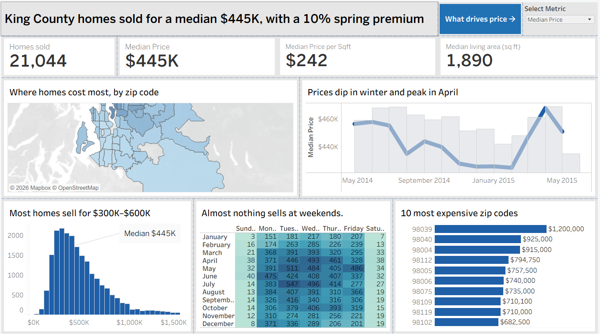
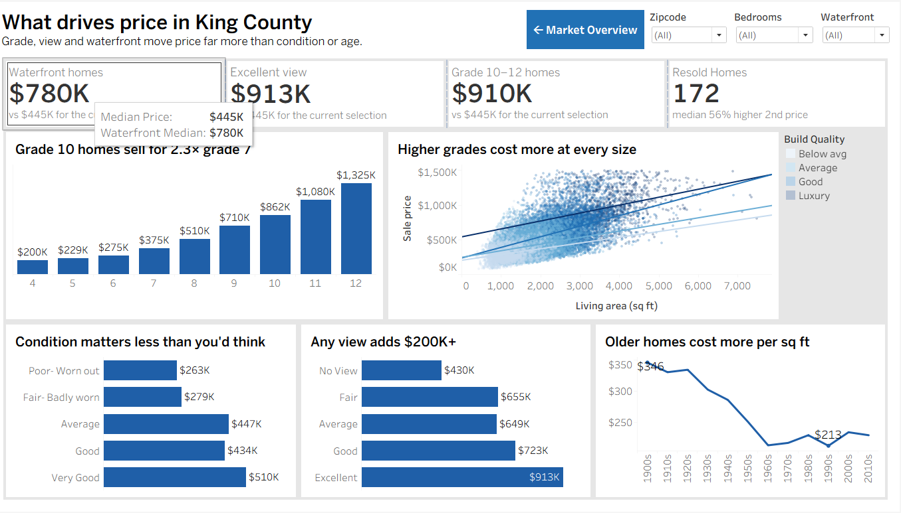

# King County housing market dashboard (Tableau)

A two-page Tableau Public dashboard on 21,044 home sales in King County, Washington (Seattle and the area around it). Page one shows where and when homes sell. Page two looks at what actually pushes a price up.

**[View the live dashboard on Tableau Public](https://public.tableau.com/app/profile/sheldon.abraham/viz/KingCountyHousing_17927083417730/MarketOverview)**



## In short

- The median home sold for $445K, or $242 per square foot.
- Build quality matters more than anything else in the data. A grade 10 home sells for 2.3 times the price of a grade 7.
- A view of any kind adds over $200K. Condition barely matters once a home is "average".
- Prices dip in winter and peak in April, and almost nothing sells at weekends.

## Why I built it

Most housing dashboards I've seen stop at "average price by area". I wanted two things on top of that. First, a page that answers the questions a buyer or agent would ask about timing and location. Second, a page that pulls apart what drives price, so you can see which features are worth paying for and which ones barely move the number.

## The data

`HouseData.xlsx` has one row per sale: 21,060 sales between May 2014 and May 2015, across 70 zip codes. Each row has the price, sale date, bedrooms, bathrooms, living area, lot size, floors, waterfront, view, condition, grade (King County's 1–13 build quality score), year built, zip code and coordinates.

It's a version of the well-known [King County house sales dataset](https://www.kaggle.com/datasets/harlfoxem/housesalesprediction). This copy only includes sales under $1.5M, so the most expensive homes aren't in it.

## What the dashboard shows

### Page 1: Market Overview

**1. Half of all sales fall between $300K and $600K.**
The median is $445K, and the typical home has 1,890 sq ft of living space. The price distribution has a long tail to the right, which is why I used the median everywhere instead of the average.

**2. Location sets the price per square foot.**
Medina (98039) is the most expensive zip at $498 per sq ft and a $1.2M median price. Bellevue (98004) and South Lake Union (98109) come next. At the other end, Federal Way (98023) is $145 per sq ft, about a third of Medina.

**3. Prices dip in winter and peak in April.**
The monthly median fell from about $458K in June 2014 to $425K in February 2015, then climbed to $468K in April. That's a 10% swing between the low point and the peak. Sales volume follows the same pattern, with January the quietest month.

**4. Almost nothing sells at weekends.**
Only 2.4% of sales were recorded on a Saturday or Sunday. That reflects when sales are registered, not when people go to viewings, but it's a useful check on the data.

### Page 2: What Drives Price

**5. Grade is the biggest single driver.**
Each step up the grade scale adds more than the one before. Grade 7 (average) homes sell for a median $375K. Grade 8 is $510K, grade 10 is $862K and grade 12 is $1.33M.

**6. Bigger homes cost more, but grade matters at every size.**
The scatter plots every sale by living area and price, coloured by grade band. At any given size, the higher-grade trend line sits above the lower ones. So it's not just that better homes are bigger.

**7. A view adds over $200K.**
Homes with no view sell for a median $430K. Even a "fair" view lifts that to $655K, and an excellent view to $913K. The 84 waterfront homes have a median of $780K.

**8. Condition matters less than you'd expect.**
Poor and fair condition homes are clearly cheaper ($263K and $279K), but there aren't many of them. Average condition ($447K) and good condition ($434K) sell for almost the same price.

**9. Older homes cost more per square foot.**
Homes built in the 1900s sell for $346 per sq ft, against $213 for homes from the 1960s and 1990s. This is mostly about location: the oldest homes are in central Seattle, where land costs the most.

**10. 172 homes sold twice within the year.**
Their second sale was a median 56% higher than the first. That's far too much to be market growth in one year, so most of these are probably renovations or flips.



## Design choices

- **Every chart title states the finding** ("Any view adds $200K+") rather than naming the chart.
- **One colour family.** Blue shows how big a number is. Darker blue on the scatter means a higher grade. No colour is used just for decoration.
- **Medians, not averages.** House prices are skewed by a few expensive homes, and the median is what a typical buyer pays.
- **A metric switch on page 1.** A parameter lets you flip the map and top zip codes between median price and median price per sq ft.
- **Click to filter.** Clicking a zip code on the map or a month on the trend line filters the rest of page 1.
- **Shared filters.** Zip code, bedrooms and waterfront filters work across both pages, and buttons move between the two.

## How I built it

### Cleaning

- Removed 16 rows with 0 bedrooms or 0 bathrooms. They're data entry errors, and they would distort the per-room figures. That leaves 21,044 sales.
- Turned the sale date text (`20141013T000000`) into a real date with `DATEPARSE`.
- **Fixed the house IDs.** The ID column was stored in Excel's "General" format, so Tableau read long IDs like 4141800215 as `4.1418E+09`. Different houses ended up with the same ID, and the repeat-sale count came out at 3,123 instead of 172. Formatting the column as a whole number in Excel fixed it.

### Calculated fields

There are 21 calculated fields and one parameter. All of them are listed in [`calculated-fields.md`](calculated-fields.md). Three did most of the work.

**Metric switch.** One field feeds the map and the top zips chart, and the parameter decides what it shows.
```
Selected Metric =
CASE [Select Metric]
    WHEN "Median Price" THEN MEDIAN([Price])
    ELSE MEDIAN([Price per Sqft])
END
```

**Repeat sales.** A FIXED level of detail expression counts how many times each house appears, whatever else is on the chart.
```
Times Sold = { FIXED [Id] : COUNT([Id]) }
Resold     = IF [Times Sold] > 1 THEN "Resold" ELSE "Sold once" END
```

**Resale gain.** The first and last sale price for each house, worked out per house and then compared.
```
First Sale Date  = { FIXED [Id] : MIN([Sale Date]) }
First Sale Price = { FIXED [Id] : MIN(IF [Sale Date] = [First Sale Date] THEN [Price] END) }
Resale Gain %    = ([Last Sale Price] - [First Sale Price]) / [First Sale Price]
```

## Checking the numbers

I checked the dashboard's figures against the raw file in Python before writing anything up.

| Measure | Value |
| --- | --- |
| Sales (after cleaning) | 21,044 |
| Median price | $445,000 |
| Median price per sq ft | $242 |
| Median living area | 1,890 sq ft |
| Waterfront median (84 homes) | $780,000 |
| Excellent view median | $912,500 |
| Grade 10–12 median | $910,000 |
| Homes sold twice | 172 |
| Median gain on resale | 56% |
| Weekend sales | 2.4% |

## Limitations

- **No homes over $1.5M.** The richest areas look cheaper than they really are, and the gaps between grades at the top end are understated.
- **One year of data.** The seasonal pattern comes from a single year, so I can't tell whether April is always the peak.
- **Features overlap.** Waterfront homes also tend to have views and high grades, so the premiums on page 2 can't simply be added together. Separating them properly would need a regression model.
- **Grade 3 is left out of the grade chart.** Only one house has it, so a bar for it would mean nothing. It's still counted everywhere else.

## What's in this repo

```
├── KingCountyHousing.twbx     # the Tableau workbook (data included)
├── data/
│   └── HouseData.xlsx         # source data
├── calculated-fields.md       # every calculated field and parameter
├── images/                    # screenshots of both pages
└── README.md
```

## How to open it

- **Easiest:** use the [live version on Tableau Public](https://public.tableau.com/app/profile/sheldon.abraham/viz/KingCountyHousing_17927083417730/MarketOverview). Nothing to install.
- **To explore the workbook:** install [Tableau Public](https://www.tableau.com/products/public/download) (free, Windows and Mac) and open `KingCountyHousing.twbx`. The data is packaged inside it.

**Built with:** Tableau Public, Excel, Python (for checking the numbers)

**Sheldon Abraham** · sheldonabraham174@gmail.com
